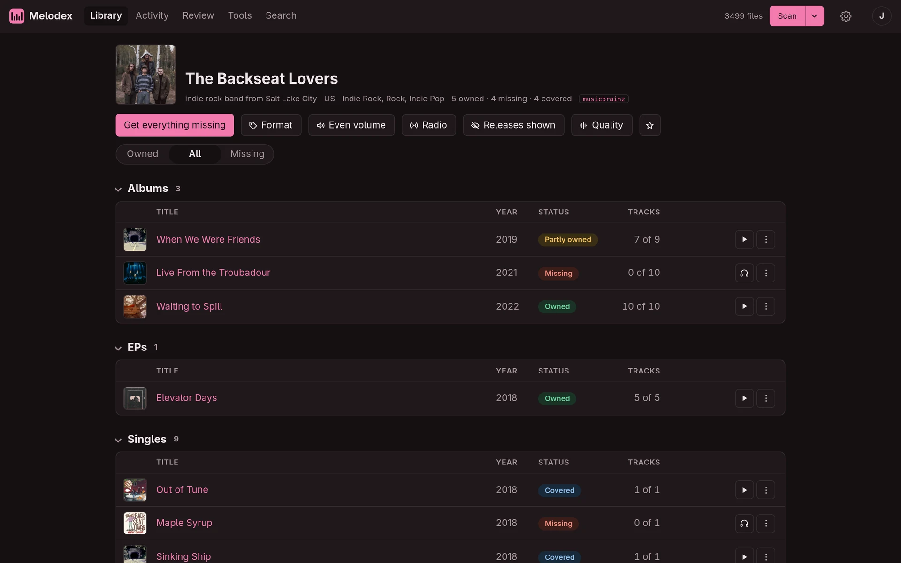
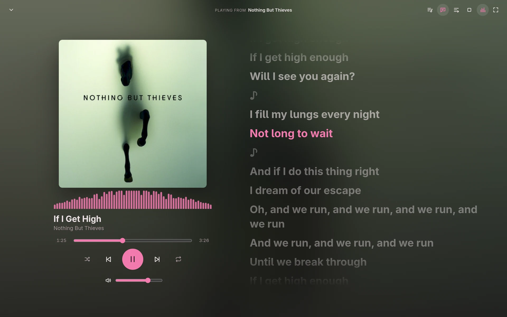
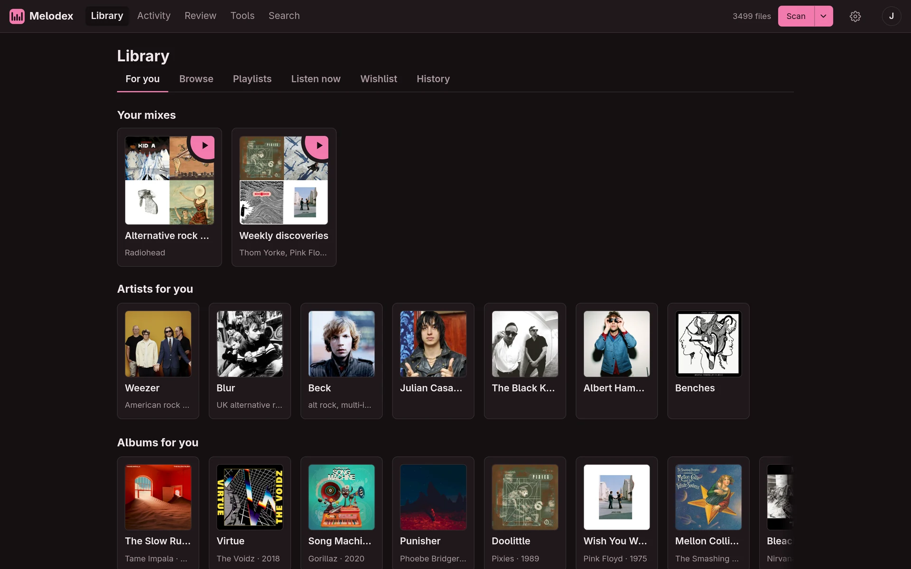
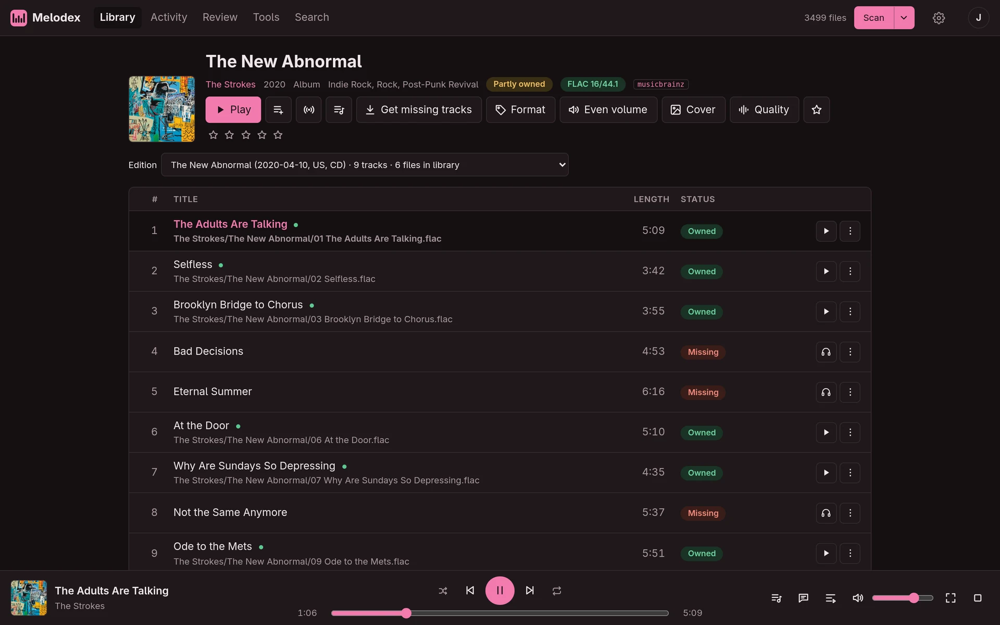
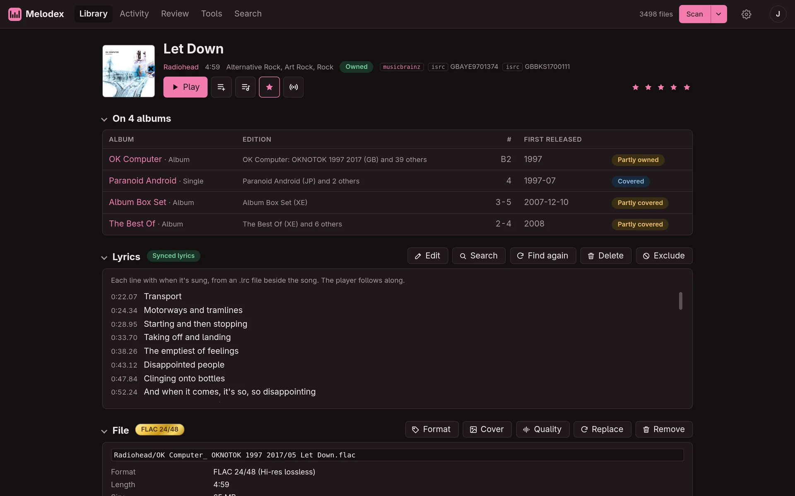
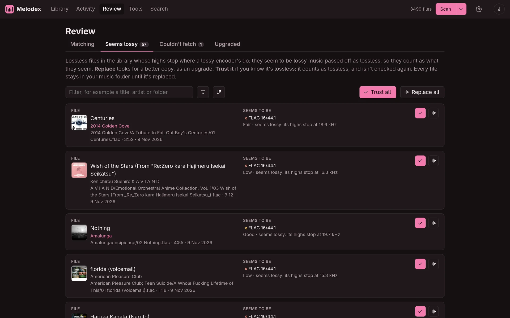
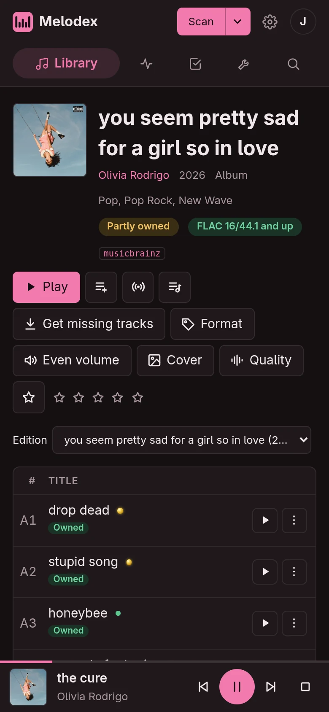

<p align="center"></p>

<h1 align="center">Melodex</h1>

<p align="center">Your music library, complete: find what's missing, fetch it, and play it anywhere.</p>

Melodex is a self-hosted music server, in the spirit of Sonarr and Radarr. It reads your music folder, matches it
against MusicBrainz, and shows each artist's albums as owned, partly owned, covered by songs on other albums, or
missing. Ask for what you want and it's fetched through plugins you choose, checked for quality, tagged and filed by
beets. Then play it: in Melodex's own web player, in any Subsonic app on your phone, or beside Navidrome, Jellyfin or
Plex, which it keeps up to date.

<p align="center"></p>

**Your library**

- **See what's missing**: every artist's discography against what you have, with official albums told apart from
  bootlegs, and songs you have on compilations counted.
- **Fetch it**: ask for a song, an album or everything an artist is missing, or put it on a wishlist for later. Every
  source is searched at once, and the best copy your quality profile allows is kept.
- **Quality you can trust**: a quality profile from hi-res FLAC down, lossless files checked for lossy music passed
  off as lossless, and songs below your cutoff upgraded as better copies turn up, held a while so you can listen and
  roll back.
- **Keep it tidy**: review files that didn't match, keep your own recordings as they are, and rewrite tags, covers,
  genres and folders from the catalogue. Lyrics are found and saved beside your songs, and Even volume writes
  ReplayGain into your files.

**Listening**

- **A full player in the browser**: gapless playback (iPhones and iPads too), even volume, synced lyrics, a
  visualiser, a queue that follows you between devices, and Listen now for songs you don't have yet.
- **Subsonic players**: Symfonium, Amperfy, Feishin and other Subsonic apps play your library straight from Melodex,
  with your playlists, stars, ratings and play queue.
- **For you**: daily mixes and weekly discoveries built from what you play, similar artists, albums and songs, and
  radio from any song, album, artist or playlist, mixing in songs you don't have yet if you like.
- **History and scrobbling**: every play is kept, with what you've played most, and sent to ListenBrainz or Last.fm.
- **Playlists**: in folders, synced with Navidrome or Jellyfin, and imported from M3U, CSV, YouTube Music,
  Deezer or Apple Music, or exported again.

**Sharing and building on it**

- **Everyone in the house**: accounts with only the permissions each person needs, their own look and their own
  notifications.
- **Plugins for everything**: sources, catalogues, artwork, lyrics, discovery, scrobbling and media servers, built in
  or at an address of your own.
- **An open API**: scoped keys, server-sent events and signed webhooks.

## A look around

<table>
  <tr>
    <td width="50%"><br><sub>The player, with synced lyrics and the visualiser</sub></td>
    <td width="50%"><br><sub>For you: daily mixes, weekly discoveries, and artists and albums like what you play</sub></td>
  </tr>
  <tr>
    <td width="50%"><br><sub>An album you partly own, playing while the rest can be fetched</sub></td>
    <td width="50%"><br><sub>A song: every album it's on, its lyrics and its file</sub></td>
  </tr>
  <tr>
    <td width="50%"><br><sub>Review: lossless files that seem to be lossy, ready to replace</sub></td>
    <td width="50%" align="center"><br><sub>On a phone</sub></td>
  </tr>
</table>

## How it compares

Melodex does in one app what usually takes three, and it's built to sit beside what you already use.

- **Lidarr** watches for new albums and grabs them from Usenet and torrents. Melodex does the same job, and it also
  counts songs you already have on compilations and other editions, so you aren't sent after albums you own in all but
  name. It gets music through any source you add as a plugin, including stores and services you pay for, or a folder you
  drop files into. It checks lossless files for lossy music passed off as lossless, and fetches an upgrade on hold so
  you can listen to both and roll back. And you can play what's missing straight away with Listen now, without adding it
  to your library.
- **Navidrome, Jellyfin and Plex** play what you have. Melodex plays it too, in its own web player or in any Subsonic
  app, with "For you", radio and scrobbling. It can also keep them up to date, and sync your playlists with Navidrome or
  Jellyfin, so you can get the best of both.
- **beets** tags and files your music. Melodex uses beets to do that, so you keep its folder layouts and its care for
  tags, without running it yourself.

If you only want to play a library that's already complete, Navidrome on its own is lighter. But Melodex is for a
library that's still growing.

## Quick start

```bash
curl -O https://raw.githubusercontent.com/dextrd/Melodex/main/docker-compose.yml
MUSIC_PATH=/path/to/your/music PUID=$(id -u) PGID=$(id -g) docker compose up -d
```

Or paste `docker-compose.yml` into a compose dashboard, such as OpenMediaVault's, Portainer or Dockge, with
`MUSIC_PATH`, `PUID` and `PGID` as its environment. Open `http://<your server>:8787`, make the admin account, and
follow the setup steps. The [installing guide](docs/guide/installing.md) has the details.

Upgrading from 1.x? See [upgrading](docs/guide/upgrading.md). Coming from Navidex? It upgrades in place: see
[upgrading](docs/guide/upgrading.md#from-navidex).

## Documentation

- [The guide](docs/guide/README.md): installing, getting started, requests, your library, playlists, Subsonic
  players, users, plugins and more. It's in the web app too, under **Settings → Help**.
- [The client guide](docs/client-guide.md), for apps that use the API. The interactive reference is at `/api/docs` on
  your server.
- [Plugin contracts](docs/contracts/README.md), for writing plugins.
- [Contributing](CONTRIBUTING.md), and [Developing Melodex](docs/development.md).
- [Security policy](SECURITY.md), for reporting vulnerabilities privately.
- [Changelog](CHANGELOG.md).

## Plugins and sources

Melodex ships no media sources. Retrieval plugins are separate services that speak an HTTP contract, each in a
repository of its own with its own image: see [the guide's Plugins page](docs/guide/plugins.md#retrieval-plugins) for
the list. You're responsible for the plugins you run and for complying with each source's terms.

## Licence

[MIT](LICENSE)
